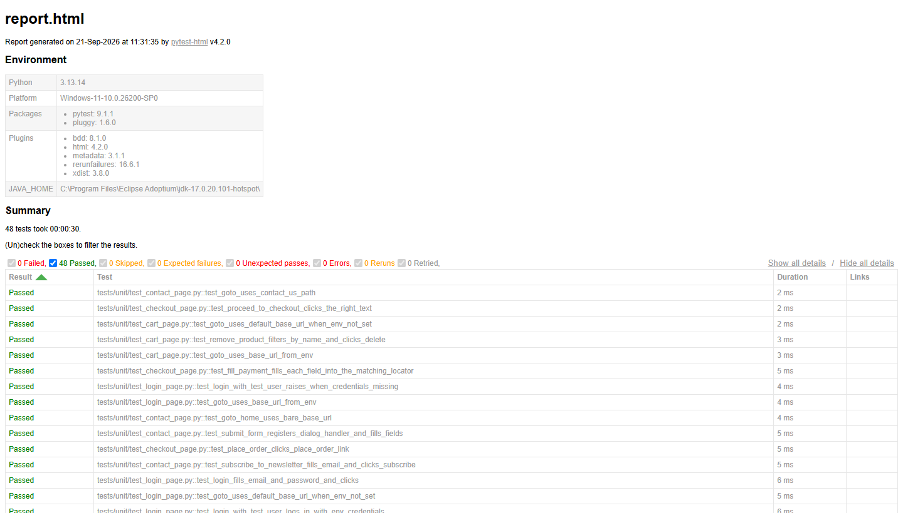

# 🧪 QA Pytest + Playwright - Automation Exercise

[🇧🇷 Português](README.md) | 🇺🇸 English


[](https://codecov.io/gh/ThomasTDS/qa-pytest-sd)


## Description

This repository contains automated tests for **[automationexercise.com](https://automationexercise.com)** using **Playwright**, **pytest-bdd (BDD/Gherkin)** and **Page Object Model (POM)**.

It's the **Python** version of [qa-playwright-sd](https://github.com/ThomasTDS/qa-playwright-sd), which covers the same scenarios and the same architecture (POM + Gherkin), originally written in TypeScript. The idea isn't a project built from scratch: the `.feature` files (Gherkin) are nearly identical between the two repositories — what changes is the language and the tools used to implement the steps and Page Objects.



---

## Project Structure

```text
qa-pytest-sd/
├── .github/
│   ├── ISSUE_TEMPLATE/    # Bug report template
│   ├── workflows/         # CI pipeline (GitHub Actions)
│   ├── dependabot.yml     # Automatic dependency updates
│   └── PULL_REQUEST_TEMPLATE.md  # Pull Request template
├── docs/
│   ├── criterios-aceite/  # User story + business rule per test case
│   ├── images/            # Screenshots used in the README
│   └── test-cases.md      # Test case traceability matrix
├── features/              # Gherkin scenarios (.feature), shared with qa-playwright-sd
├── steps/                 # Step implementations (pytest-bdd)
├── pages/                 # Page Objects (LoginPage, RegisterPage, ...)
├── tests/                 # Files linking each feature to its steps (E2E) and unit tests (tests/unit/)
├── reports/               # HTML report generated on each run (not versioned)
├── allure-results/        # Raw Allure Report data (not versioned)
├── conftest.py            # pytest fixtures (browser, page, screenshot and trace on failure)
├── pyproject.toml         # pytest, ruff and mypy configuration
├── requirements.txt       # Project dependencies
├── .env.example           # Environment variable template
├── Dockerfile             # Image for running the tests in a container
├── SECURITY.md            # Repository security policy
├── LICENSE                # MIT License
└── README.md              # This file (Portuguese version)
```

---

### Clone the repository

```
git clone https://github.com/ThomasTDS/qa-pytest-sd.git

cd qa-pytest-sd
```

### Create a virtual environment and install dependencies

Requires Python 3.12 or higher.

```
python -m venv .venv

# Windows
.venv\Scripts\activate

# Linux/macOS
source .venv/bin/activate

pip install -r requirements.txt
```

### Install Playwright browsers

```
playwright install
```

### Credentials setup (.env)

The login scenarios use an account that already exists on automationexercise.com, defined via environment variable (never hardcoded in the code). Copy `.env.example` to `.env` (not versioned) and fill it in:

```
BASE_URL=https://automationexercise.com/
HEADLESS=false
TEST_USER_EMAIL=
TEST_USER_PASSWORD=
```

In CI, those same variables come from GitHub Secrets (`TEST_USER_EMAIL`/`TEST_USER_PASSWORD`), configured on the repository.

### Run with Docker

The `Dockerfile` uses the official Playwright image for Python (already with Chromium, Firefox and WebKit installed), so there's no need to install Python or browsers locally.

```bash
docker build -t qa-pytest-sd .

docker run --rm --env-file .env -v "$(pwd)/reports:/app/reports" qa-pytest-sd
```

`--env-file .env` passes the test credentials to the container, and the volume on `reports/` brings the generated HTML report back to the host machine. To run on another browser or with another command, override the `CMD`, for example:

```bash
docker run --rm --env-file .env -e BROWSER=firefox -v "$(pwd)/reports:/app/reports" qa-pytest-sd
```

### Run all tests

```
pytest
```

**NOTE:** _By default, tests run with the browser visible (headless = false). To run headless (e.g., like in CI), use the `HEADLESS` environment variable:_

```
# PowerShell
$env:HEADLESS="true"; pytest

# bash
HEADLESS=true pytest
```

### Run on another browser

By default tests run on **Chromium**. To run on **Firefox** or **WebKit**, set `BROWSER` (make sure the browser is installed first — see "Install Playwright browsers"):

```
# PowerShell
$env:BROWSER="firefox"; pytest

# bash
BROWSER=firefox pytest
```

Accepted values: `chromium` (default), `firefox`, `webkit`.

API tests (`@api`) don't use a browser, so they don't depend on `BROWSER`. In CI, they run only on Chromium; to skip them locally, use `pytest -m "not api"`.

### Run in parallel

Scenarios are independent from each other (each one opens its own browser), so they run well in parallel via **pytest-xdist**. CI already runs this way (`-n auto`, which uses all available cores on the runner):

```
pytest -n auto
```

For a fixed number of workers, use `-n 4` (or the desired value) instead of `auto`.

### Run only the smoke test

Scenario `TC-007` (full checkout) is tagged `@smoke` and covers login, products, cart and checkout in a single end-to-end flow:

```
pytest -m smoke
```

### Run only the unit tests

Besides the E2E scenarios (BDD, against the real site), `tests/unit/` covers the Page Objects' logic — reading `BASE_URL`, building selectors, conditionals like the optional `country` field — with Playwright's `Page` mocked. They don't open a browser, don't depend on the network and run in seconds:

```
pytest -m unit
```

### Run against another URL

By default tests target `https://automationexercise.com/`. To run against another environment, set `BASE_URL`:

```
# PowerShell
$env:BASE_URL="https://another-environment.com/"; pytest

# bash
BASE_URL=https://another-environment.com/ pytest
```

### HTML Report

```
pytest --html=reports/report.html --self-contained-html
```

Each run generates `reports/report.html` (not versioned) with the scenario results. Failing tests automatically get a screenshot at the moment of failure attached to the report, to make diagnosis easier.

Besides the screenshot, every failing test also saves a **navigable Playwright trace** in `traces/` (not versioned) — it records screenshots, DOM snapshots and network requests throughout the whole scenario, not just the moment of failure. The file path shows up in the HTML report itself. To open it:

```
playwright show-trace traces/<file>.zip
```

### Allure Report

Besides pytest's HTML, it's possible to generate data for the [Allure Report](https://allurereport.org/) in `allure-results/` (not versioned):

```
pytest --alluredir=allure-results
```

Generating and viewing the report requires the [Allure Commandline](https://allurereport.org/docs/install/) installed locally (it's not a pip package, it's a separate Java tool — via Scoop on Windows: `scoop install allure`, via Homebrew on macOS/Linux: `brew install allure`, or downloading the `.zip`/`.tgz` from the [releases page](https://github.com/allure-framework/allure2/releases)):

```
allure generate allure-results --clean -o allure-report   # generates allure-report/ from allure-results/
allure open allure-report                                  # opens the generated report in the browser
# or, without generating first:
allure serve allure-results
```

Allure groups scenarios by suite, shows the status of each run and attaches the same extras as the HTML report (screenshot and trace on failure, accessibility note when axe-core finds violations) — it's more navigable than pytest-html's plain HTML for investigating a large suite or comparing runs.

### Code coverage

To measure which lines of the Page Objects and steps are exercised by the suite:

```
pytest --cov                                  # terminal summary, with uncovered lines
pytest --cov --cov-report=html                # generates htmlcov/index.html with per-file detail
```

Coverage considers `pages/` and `steps/` (configured in `pyproject.toml`). The coverage backend is `sysmon`, because the Playwright sync API uses greenlets and the default tracer loses lines executed right after browser calls — with the default backend, `api_page.py` showed up at ~69% instead of ~98%.

High coverage doesn't guarantee the scenarios verify the right behavior; use the report to find paths that no test exercises, not as a target.

In CI, coverage is measured on the Chromium run and uploaded to [Codecov](https://codecov.io/gh/ThomasTDS/qa-pytest-sd), which feeds the badge at the top of this README. The upload requires the `CODECOV_TOKEN` secret; without it, CI stays green, but the badge doesn't update.

### Lint, formatting and type checking

The project uses **ruff** (lint + formatting) and **mypy** (type checking):

```
ruff check .           # checks for lint issues
ruff check . --fix     # fixes what it can automatically
ruff format .          # formats all files
ruff format --check .  # only checks, without changing (used in CI)
mypy .                 # checks for type errors
```

To run these checks automatically before each commit, install the **pre-commit** hook (already included in `requirements.txt`):

```
pre-commit install
```

From then on, every `git commit` runs `ruff check --fix`, `ruff format` and `mypy` on the changed files. To run it manually against the whole repository:

```
pre-commit run --all-files
```

---

### Test Structure and Patterns Applied

- BDD / Gherkin: clear, readable scenarios in `.feature`, shared with the TypeScript sibling project.
- Page Object Model (POM): separation of concerns, with Pages encapsulating elements and actions.
- End-to-End (E2E) tests: simulation of real user flows.
- API tests: direct validation of the site's public API contract (`features/api.feature`), without going through the UI — faster and less brittle for verifying back-end business rules.
- Dynamic test data: name, company, address and phone used during signup (UI and API) are generated on every run with [Faker](https://faker.readthedocs.io/) (`pt_BR` locale), instead of fixed values.
- Accessibility: key pages (login, products) are scanned with [axe-core](https://github.com/dequelabs/axe-core) via [axe-playwright-python](https://pypi.org/project/axe-playwright-python/), checking for `critical`/`serious` impact violations. It's passive QA — violations found become a note in the HTML report, without failing the test.

### Third-party site instability

The site under test (automationexercise.com) isn't controlled by this project, and sometimes responds with server errors (HTTP 5xx) to some requests, mostly on WebKit. In those cases, the page gets stuck on an error screen and the scenario would fail even with correct code.

To avoid masking this with spurious failures, some steps retry the action with a fixed limit (2 attempts):

- **Logout**: if the page doesn't redirect to `/login`, it's reloaded.
- **Sign-up and account deletion**: if the form doesn't advance or the confirmation doesn't appear, the step is retried.
- **Products and search**: if the products page or the results page doesn't load, it's reloaded.
- **Add to cart**: the click is retried only when the site responds with 5xx. Since the item wasn't added in that case, retrying doesn't duplicate anything.

Each retry shows up as a **note in the HTML report and in Allure**, on the scenario itself. That way, a scenario that only passed after retrying stays visible to whoever reviews the run.

Tests that needed a rerun from pytest-rerunfailures (`--reruns 1`) are also logged in `reports/flaky-tests.tsv`, and CI publishes a summary with those cases.

Retrying a step doesn't fix the site. If instability increases, the report shows which steps are retrying more often.

---

### CI/CD

The project runs automatically via GitHub Actions (`.github/workflows/tests.yml`) on every push/PR to `main` and daily at 06:00 UTC. Before the tests, CI validates lint (`ruff check`), formatting (`ruff format --check`) and types (`mypy`), breaking the build if anything is out of standard. The suite runs three times — once per browser (Chromium, Firefox and WebKit) — each in parallel (`pytest -n auto`, via pytest-xdist), accumulating the results of all three into a single Allure report. Each browser's HTML report and the consolidated Allure report are published as artifacts of the run. Failing scenarios are automatically rerun once (`--reruns 1`), to absorb one-off network instability without masking real code bugs.

Pip dependencies and Playwright's browser binaries are cached between runs (`actions/cache`, automatically invalidated when `requirements.txt` changes), which avoids re-downloading ~200MB of browsers on every run.

### Pipeline security

- `pip-audit` runs in CI on every run, breaking the build if a known vulnerability is found in a dependency.
- **Dependabot** active (`.github/dependabot.yml`): automatic weekly updates for pip dependencies and workflow actions.

`main` is protected: changes must go through a Pull Request with a green test check.

---

### QA Documentation

- Bug report template at `.github/ISSUE_TEMPLATE/bug_report.md`, with severity (technical impact) and priority (urgency to fix) handled as separate fields, and root cause filled in only after real investigation.
- Pull Request template at `.github/PULL_REQUEST_TEMPLATE.md`, with a local-testing checklist before opening the PR.
- Traceability matrix at `docs/test-cases.md`, linking each test case to its corresponding `.feature` scenario via the `@TC-XXX` tag.
- Acceptance criteria (user story + business rule behind each test case) in `docs/criterios-aceite/` (in Portuguese).
- Repository security policy in `SECURITY.md` (scope, supported versions, how to report).

---

## License

Distributed under the MIT license. See [LICENSE](LICENSE) for details.
